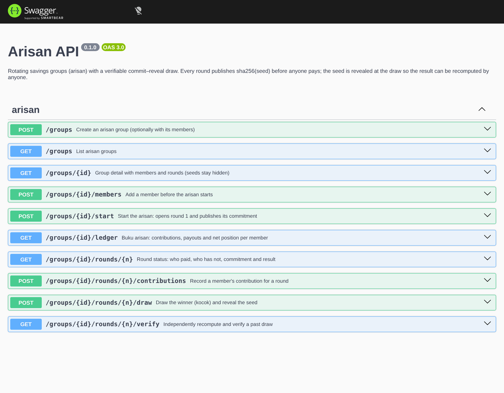

# arisan

**A REST API for *arisan* — Indonesian rotating savings groups — with a draw anyone can verify.**

In an arisan, every member pays the same amount each round and one member takes the whole pot,
until everybody has won exactly once. The weak spot has always been the *kocok* (the draw):
names on rolled-up paper in a glass, run by the organiser. `arisan` keeps the books and makes
the draw **provably fair** with a commit–reveal scheme.



## How the fair draw works

```
round opens   server picks a random 256-bit seed, publishes only  commitment = sha256(seed)
members pay   nobody can change the seed any more — the commitment is public
draw          members supply public entropy (e.g. numbers shouted at the meeting)
              digest  = HMAC-SHA256(key = seed, "arisan-v1|round|entropy|sorted eligible ids|attempt")
              index   = first 64 bits of digest mod #eligible   (rejection sampling → no modulo bias)
              winner  = eligible[index]; seed is revealed
verify        anyone checks sha256(seed) == commitment and recomputes the winner
```

The organiser can't pick the winner (the seed was fixed before the entropy was known), and the
members can't either (they don't know the seed). `GET /groups/:id/rounds/:n/verify` returns every
input and intermediate value; the e2e test recomputes a draw with nothing but `node:crypto`.

## Features

- Groups with weekly or monthly rounds (month-end aware: 31 Jan → 28 Feb → 31 Mar) and an optional organiser fee.
- Contributions per round; the draw is refused until everyone has paid (`409` lists who hasn't).
- Each member wins exactly once; the group finishes automatically after the last round.
- **Buku arisan** ledger: contributed, received, net position and what is still owed, per member.
- Validation with **Zod**; the same schemas generate the **OpenAPI** docs at `/docs`.
- Real Postgres semantics (constraints, enums, transactions, `SELECT … FOR UPDATE`) via **PGlite**,
  Postgres compiled to WebAssembly — no database server to install, in-memory for tests, on disk in dev.

## Stack

NestJS 11 · Drizzle ORM · PGlite · Zod 4 · Swagger · Jest + Supertest · Biome

```
src/
├── draw/draw.ts            commit–reveal draw, unbiased index, verification (pure, no I/O)
├── common/schedule.ts      due dates, payout & fee
├── common/zod.pipe.ts      Zod validation pipe + Zod → OpenAPI
├── db/schema.ts            Drizzle schema (groups, members, rounds, contributions)
├── db/database.module.ts   PGlite + migrations as a Nest provider
└── groups/                 controller, service, DTO schemas
drizzle/                    generated SQL migrations
test/arisan.e2e-spec.ts     full arisan lifecycle over HTTP against in-memory Postgres
```

## Run

```bash
npm install
npm run dev        # http://localhost:3000, Swagger at /docs, data in ./data/pglite
npm run demo       # in another terminal: creates a group, collects, draws and verifies two rounds
npm test           # 20 tests (unit + e2e)
```

Example:

```bash
curl -X POST localhost:3000/groups -H 'content-type: application/json' -d '{
  "name": "Arisan PKK RT 05", "contribution": 100000, "frequency": "monthly", "adminFeePct": 2.5,
  "members": [{"name": "Bu Sri"}, {"name": "Bu Ani"}, {"name": "Pak Budi"}]
}'
```

| Method | Path | |
|---|---|---|
| `POST` | `/groups` | create group (+ members) |
| `POST` | `/groups/:id/members` | add member (before start) |
| `POST` | `/groups/:id/start` | start, open round 1, publish commitment |
| `GET` | `/groups/:id/rounds/:n` | paid / unpaid, commitment, result |
| `POST` | `/groups/:id/rounds/:n/contributions` | record payment |
| `POST` | `/groups/:id/rounds/:n/draw` | draw winner, reveal seed, open next round |
| `GET` | `/groups/:id/rounds/:n/verify` | recompute & verify |
| `GET` | `/groups/:id/ledger` | buku arisan |

See [ROADMAP.md](ROADMAP.md).

## License

MIT
